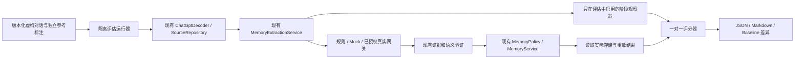

# V0.2.1：记忆质量评估体系

## 边界与架构

本阶段只增加评估能力，不重写记忆引擎，不新增数据库迁移、HTTP API、外部数据库或 Agent 框架。现有 Java 21 / Spring Boot 4.0.8 / Spring AI 2.0.1 和 Token API 保持兼容。

`MemoryEvaluationService` 是显式创建的工具对象，不是生产 Spring Bean。生产代码唯一接入点是 `MemoryExtractionService.extract(..., ExtractionObserver)` 重载；原三参数入口使用无操作观察器。观察器只提供候选、验证拒绝、落库及安全错误码，默认不保存或记录原文。

离线 `FixtureModelGateway` 只替换 ModelGateway 的响应，输出取自单独的固定快照。真正的 LLM JSON 解析、证据验证、语义验证解析、策略、事务、去重、冲突检测、来源授权都运行生产实现。Mock 中故意注入错误，包括宽松语义判断导致的策略问题；其分数只证明工具能观察和分类结果，**不能用来宣称 DeepSeek 或真实 LLM 的质量**。另有 OFFLINE_RULE 模式测量当前规则提取器本身。

评估案例通过实际 ChatGPT 解码器产生消息与分支，用 SourceRepository 保存 L0，提取后读取 MemoryRepository 的真实存储结果。额外集成断言使用完整 ChatGptImportService → 无授权阻断 → 授权 → Mock 提取 → 验证 → 持久化 → 检索证据链路，同时检查原始消息未被改变、重复导入及重复提取幂等。

## 数据契约与人工标注

详见 [JSON Schema](../evaluation/dataset.schema.json) 和 [虚构数据集](../evaluation/datasets/memory-quality-v1.json)。顶层 schemaVersion 与 datasetVersion 独立；报告记录整个原始数据文件 SHA-256。`fictional=true` 必须存在。运行器只允许稳定 ASCII 标识、合法枚举、非空多轮消息、无环父链、真实存在的证据节点、逐字引文及 UTF-16 `[start,end)` 位置。

caseId 是跨运行稳定标识；数据库 UUID 每次隔离生成，报告引用 messageId 而非随机 UUID。来源 locator 为 `caseId:messageId`，包含节点角色与 statedAt；statedAt=null 明确表示时间未知。selectedLeaf 指定实际对话分支，非选中分支不能成为标准答案证据。expectedMemories 可为空，forbiddenClaims 独立描述禁止的归因、否定反转、假设变已发生等内容。

每条 Gold 有 type、origin、语义说明、人工可审阅的 acceptedContents、可选概念组/排除词、证据 ANY/ALL、时间范围、敏感等级与预期审核状态。引用和措辞应分别评审，不能把被评估模型的输出直接提升为正确答案。本版工程参考标注为 `PENDING_HUMAN_REVIEW`；未宣称已完成人类审核。Live 必须由操作者另行审核虚构数据并提供精确文件摘要作为外发批准。

## 匹配、TP/FP/FN 与指标

先在每个案例内部建立预测与 Gold 的兼容边，再用增广路径求最大一对一匹配，避免重复输出提高 Recall 或贪心匹配漏算。语义接受条件为：规范化后与某个人工列出的等价表述一致，或满足所有人工指定概念组且不含排除概念。没有在线 LLM judge，不因单纯字符串不同就判错。

- **TP**：一对一匹配，同时满足语义、MemoryType、AssertionOrigin、时间范围和指定的用户原文证据。审核状态另计，防止语义正确掩盖自动写入推断。
- **FP**：可确认的错误、证据无效、命中 forbiddenClaims、错误类型/归因/时间，或抢占同一 Gold 的重复结果。
- **Pending**：证据有效、未发现已知错误，但无法自动确认的改写/新增语义，标记 `PENDING_HUMAN_REVIEW`，不算已确认 FP。
- **FN**：未获得确定匹配的 Gold；有待复核预测时仍保留保守 FN 数，避免提前假定正确。报告显式列 Pending 和 resolvedCoverage；待审核覆盖的 Gold 不重复输出确定 MISSING_MEMORY 错误。

当 Pending>0，Precision/Recall/F1 是保守的已确认匹配分数，不能误解成已经由人确认的最终准确率。P=`TP/预测数`，R=`TP/Gold数`，F1=`2TP/(预测数+Gold数)`；Pending=0 时回到常见 P/R/F1。TP+FP+Pending=预测数，TP+FN=Gold数。每个指标输出分子、分母，分母为 0 输出 null / N/A；空预测且空 Gold 不冒充 100%。另有 correctEmptyCases 统计正确空存储结果。

| 指标 | 分子 / 分母 |
|---|---|
| evidenceAccuracy | 来自选中 user 消息、逐字定位且满足指定证据锚点的预测 / 全部预测 |
| attributionErrorRate | assistant/第三方误归因或 forbidden 归因错误预测 / 全部预测 |
| temporalAccuracy | 匹配参考语义且时间范围正确数 / 可自动判定时间的预测数 |
| reviewPolicyAccuracy | 实际存储状态与 Gold 或既有安全策略一致数 / 有状态且可判定的预测数 |
| unsupportedMemoryRate | 无效/不存在的证据、已知归因或无依据陈述错误数 / 全部预测 |
| deduplicationAccuracy | 对有实际存储记忆的相同来源重放后 实际再次接受候选、0 新增且原 ID 集不变次数 / 这些重放次数 |
| privacyViolationRate | 存在未经授权调用、敏感自动激活或审核策略错误的案例数 / 案例数 |
| resolvedCoverage | 已确定 TP 或 FP / 全部预测 |

空存储案例不计去重分母，以免用“什么都没存”抬高去重分数。重复导入另由完整链路测试断言。分类标签可重叠，所以分类统计不能相加当总体；总体采用 micro counts 汇总。所有模型调用数包含重复提取和语义验证，初次候选与存储评分只计首轮。

原模型只表达 SOURCE_TIME/HISTORICAL；未来计划、假设和否定通过保留完整限定语的语义标注及 forbiddenClaims 评估，不在本阶段改生产枚举。时间准确率是**可判定子集**指标，未知改写不假装已经理解时间；不能只看这一项判断完整时间推理能力。

## 阶段差异与错误分类

每案分别报告 EXTRACTION 与 PERSISTENCE 的 TP/FP/FN、指标、未决匹配，并记录 EVIDENCE_VALIDATION、SEMANTIC_VALIDATION 的拒绝数量。模型格式错、模型不可用、验证格式错、持久化失败与拒绝候选分开，后者不等同于模型失败。存储侧读取实际状态与敏感级别，不能用模型自报“已审核”代替数据库结果。

错误码包含 MISSING_MEMORY、UNSUPPORTED_CLAIM、WRONG_ATTRIBUTION、WRONG_TEMPORAL_SCOPE、WRONG_MEMORY_TYPE、WRONG_ASSERTION_ORIGIN、INVALID_EVIDENCE、REVIEW_POLICY_VIOLATION、SENSITIVE_DATA_VIOLATION、DUPLICATE_MEMORY、MODEL_FORMAT_ERROR、MODEL_UNAVAILABLE、VALIDATOR_REJECTION、VALIDATOR_FORMAT_ERROR、PERSISTENCE_ERROR、PENDING_HUMAN_REVIEW、WRONG_BRANCH、MISSING_CONFLICT、UNEXPECTED_BLOCK。一个预测可能有多项问题，错误事件数不是 FP 数。

## 隐私和运行隔离

所有模式只允许 `mirror_self_evaluation_*` 数据库，执行写入前检查 `current_database()`。测试使用 PostgreSQL17/pgvector 临时容器、新 owner、现有 Flyway 迁移，不读取业务来源，不删除已有记忆或覆盖 `.env`。测试中 RESTRICTED 场景的更新仅限刚创建的虚构来源。

Live 需要 MIRROR_EVALUATION_LIVE_ENABLED=true、精确数据集 SHA-256、MIRROR_MODEL_EGRESS_ENABLED=true、有效模型配置及逐来源授权。未授权、SECRET、RESTRICTED 场景的网关调用数应为 0；调用计数器不保存 Prompt、响应或密钥。固定 Mock 模式的主网关不会联网，即使外部环境里存在真实 Key。

报告仅写案例 ID、错误类别、计数和版本信息，不序列化源消息、预测正文、原始 provider 异常、推理、凭据或 HTTP Header。ModelGateway 当前只返回 String，无法获得原生 token usage，故报告为 null 并写明 not_exposed_by_ModelGateway；不估算费用或虚构用量。

## Baseline、门槛与复现

运行命令、审核步骤及环境变量见 [evaluation README](../evaluation/README.md)。结果默认写 target/evaluation/{offline-mock,offline-rule,live}。JSON reportVersion=1.0，metricVersion=memory-quality-1.0；Markdown 列总体、34 类场景、阶段差异、失败与优化优先级。

仅当 metricVersion、datasetSha256、mode 和案例集合一致时可比较。模型/提取器版本允许变化，正是比较目标。输出总体/分类指标 delta 和按 caseId+stage+error+goldId 聚合的新增/修复失败签名；不比较随机 UUID、顺序、时长或启动时间。没有可比基线时给出原因，不生成虚假的改进百分比。

GitHub Actions 工作流对 PR 与 main 推送执行 Java 21 / Maven verify，固定 Action 提交版本，只授予读取仓库权限，显式关闭 Live，并保存评估报告。Docker 不可用则先失败，不接受跳过集成测试的假绿。

离线 CI 锁定固定数据、固定响应与实测基线，发现总体或分类退化、失败新增/消失时失败并保留报告。Live 默认不做质量硬门槛，避免探索波动污染 CI；需要质量门槛时单独指定 thresholds 配置。阈值分母未知不会被当作通过。baseline 的更新需经过差异审阅，不能只为使测试变绿而改分数。

## 已知限制与后续工作

工程参考标注仍需独立人类审核；当前语义匹配是可解释的有限规则和人工别名，不是通用语义裁判。对未知语义明确保留待复核。敏感分类和冲突检测沿用 V0.2 启发式能力，报告会暴露不足，不在评估阶段悄悄改变生产算法。

本阶段没有执行付费 DeepSeek 全量评估，真实模型准确率尚未测量。先审核 Gold，再按少量案例执行已授权 Live，检查提取与验证损失，随后对 Prompt/验证器单变量实验并比较同一数据集。只有 Live 结果能支持模型间质量判断，Mock 故障注入仅支持工程回归结论。
