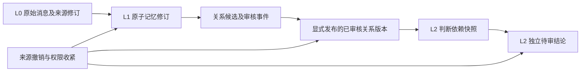

# V0.3 提案：已审核关系版本图与九维推断依赖

**仅设计，不实现图服务、九维人格生成或自主Agent。** 继续使用PostgreSQL，不新增图数据库/MQ/微服务。M2候选APPROVED表示用户认可某个证据关系，不等于证实用户当前人格、价值观、永恒偏好或客观真相。

## 层次与稳定身份

建议未来新增relation_edge稳定ID + relation_edge_version不可变版本，owner_id贯穿。每版本保存subject/object明确方向、SAME_AS/CONTRADICTS对称性质、来源candidateId及candidate修订、两端L1 ID+revision、L0 source ID+revision/quote位置、判定/规则版本及审核事件ID。对称边仍保持规范排序，有向边明确from/to，不能通过排序悄悄翻转。SAME_AS不是实体物理合并，原ID和证据仍保留。

原memory_relation为旧占位关系，不直接当作已审核图；其导入需独立人工核验和可追溯迁移。新Schema只经未来新Flyway迁移，现阶段不执行。

## 时间与认识状态

分别保存valid_from/valid_to（事实适用期，可未知/开区间）、source_occurred_at（用户消息时点）、recorded_at（系统接收）、reviewed_at（审核事件时间）和版本序号。不从SOURCE_TIME自动生成“从该日到永远有效”。相对时间需绑定来源锚点和解析版本；未知区间保持UNKNOWN，过去与现在并存。

图边另有epistemic_scope：USER_EXPLICIT_SELF_REPORT、EVIDENCE_SUPPORT、POSSIBLE_EVOLUTION等；CURRENT_ENDORSEMENT默认为UNCONFIRMED。用户批准自述之间等价，不自动确认客观人格。墙钟未修复前，时间记录标可信程度；不能凭未经验证的报告时间裁定观点先后或授权有效期。时钟修复仍是独立运维任务。

## 反证、冲突与演化

允许同一命题的支持/反证同时存在，禁止按向量排名或“最新写入”静默胜出。冲突作为稳定conflict_set及成员版本，保留时间范围、条件、不同用户表达与未决点。EVOLVED_FROM仅说明可能演化，并保留旧观点及依据；有向演化环进入争议，不自动选择一条时间线。SUPPORTS不证明事实连续存在，CONTRADICTS不抹掉任一原文。

类型或方向冲突的新版本默认PENDING_REVIEW，不覆盖已发布边；已发布但出现反证可标CONTESTED并禁止作为无争议L2证据，保留历史可解释性。发布/争议状态是关系治理状态，不是对用户人格的二元裁决。

## 审核、人工纠正与撤销事件

未来采用append-only的PROPOSED、APPROVED、REJECTED、PUBLISHED、CONTESTED、CORRECTED、REVOKED事件，记录owner/reviewer、作用对象版本、expectedVersion和固定原因。正文理由可能敏感，须owner私有，不复制到普通日志。纠正创建新版本并引用supersedesEvent，原审核不可改写；改变类型、方向或时间范围均需重新审核。

候选审核API现有RELATION_REVIEW_ONLY契约保持。未来由独立显式“发布已审核关系”命令完成promotion：核对候选仍APPROVED且无冲突、两端及全部L0修订/权限仍一致、版本前置条件有效；一事务写版本、事件与依赖。不能用旧批准给变化后的证据背书。对已批准边的撤销和纠正是独立授权操作，不包含在普通扫描或模型调用中。

## 溯源与权限执行

relation_evidence_version关联每个边版本的L1/L0修订、引用偏移与原文摘要哈希，保留证据“在哪里”，尽量不额外快照私人原文。所有SQL入口及每一跳图遍历检查owner、状态、隐私和证据可用性，不能只靠起点过滤、模型Prompt或前端隐藏。跨owner边复合FK禁止；RESTRICTED/SECRET未来只能走独立权限策略，默认不进入通用关系图或L2推断。

异步投影只能作为缓存；读取时仍核对依赖修订，避免撤回传播延迟泄漏失效边。提供as-of版本查询时，也必须使用当前隐私权限；历史权限不能成为读取已删除私人正文的后门。

## L2九维推断如何依赖图

经历、知识、思维、人格、价值观、情绪、人际关系、目标动机、自我认知的每个claim_version引用明确的edge_version集合及最终L1/L0依赖快照，同时记录模型/规则版本、时间范围、反证、不确定性和可撤销批准。不同维度不共享一个未经审核的人格标签。

显式事实可作为已审核输入，推断结论仍独立PENDING_REVIEW，任何APPROVED关系都不能绕过L2审核。模型不能自动把“用户曾自评耐心”升级为“用户具有稳定耐心人格”，也不能将一次情绪、条件目标或过去价值表达推广到现在。L2接受反证与相互冲突结论的待审共存，要求用户选择范围、标注争议或撤回；不强迫形成单一完整人格。

若未来调用云模型，必须对全部参与L0及查询执行PrivacyGateway/逐来源短期授权；图边批准不包含外发授权。九维推断不自带工具权限或对外数字分身权限。

## 撤销传播与删除

维护反向dependency表：source_revision → memory_revision → edge_version → claim_version。来源撤销/删除/隐私收紧、L1撤回或证据变化时，同事务标记直接边STALE/REVOKED及递增依赖epoch；所有依赖L2立即不再可供回答，进入STALE/PENDING_REVIEW，不能继续作为已确认事实。后台可重算投影，但不能恢复原批准；重新推断仍需新版本及审核。

L0硬删除后删除额外原文副本和向量，审计只保留不含正文的ID/tombstone及必要事件。不能从审计恢复受限原文。外部备份按独立保留/删除策略处理，不因图级联绕过业务数据授权。被引用证据变化后相同文本也不是同一已审核修订。

## 进入V0.3的条件与小步实施

先完成M2-QG独立人工参考复核、本轮真实BGE的DEV/HOLDOUT分阶段验收和安全零容忍门禁；CI绿灯或Mock成绩不能替代。之后先实现显式发布、只读版本图、撤销传播和人工纠正的隔离测试，再考虑单一维度的可解释待审L2实验。未通过覆盖门禁时，应保留失败报告、设计新留出集，不能调低阈值、修改参考或自动冻结正式Baseline。
